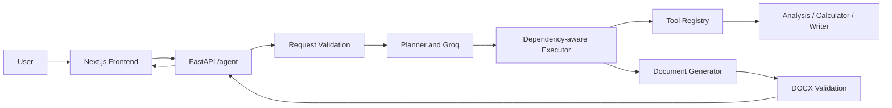

# TaskPilot AI

TaskPilot AI turns a natural-language business or technical request into a planned, traceable execution and a validated Word document. The backend uses a language model to construct the plan and draft content; Python validates dependencies, runs tools, and creates the DOCX. It does not perform web research.

## 1. Project Overview

The project addresses the gap between a free-form request and a usable professional document. Instead of returning only chat text, TaskPilot selects a document type, records assumptions, plans distinct tasks, executes them in dependency order, and returns a real `.docx` encoded in the API response.

## 2. Core Features

- Groq-generated structured multi-step plans with task dependencies.
- Deterministic dependency-aware execution with recorded statuses, results, errors, retries, and logs.
- Registered analysis and safe arithmetic tools, plus model-backed writing and a dedicated DOCX tool.
- DOCX archive and main-content validation before returning the file.
- One-page Next.js interface with actual API results and browser download.

## 3. Technology Stack

Python 3.11, FastAPI, Pydantic, Groq's Python SDK, python-docx, pytest, and httpx power the backend. Next.js, React, TypeScript, Tailwind CSS, and Lucide provide the frontend. Docker and Render configuration support the backend deployment; Vercel supports the frontend.

## 4. System Architecture



## 5. Agent Workflow

The frontend sends `POST /agent` and waits for the synchronous response. FastAPI validates the request, then the planner asks Groq for a JSON plan and validates the result against Pydantic models. The executor picks the first pending task whose prerequisites completed. It invokes the assigned tool, captures output or failure, and records the transition. Once the document task becomes eligible, the model composes sections from prior outputs and the document tool creates and validates a DOCX archive. The response includes plan state, assumptions, logs, counts, and Base64 document data.

## 6. Planning Logic

The LLM analyzes the request and returns the document type, title, missing information, assumptions, and 3–8 tasks (the schema accepts 2–12). Each task selects one of `analysis`, `calculator`, `writer`, or `document`. The planner rejects duplicate IDs, missing dependencies, cycles, unsupported tools, and plans without a final document task. When a plan is rejected, the reason is sent back to Groq once for a corrected plan; a second rejection returns 502. The executor repeatedly selects eligible tasks in plan order; it never runs a task before its dependencies complete. Each task receives only the outputs of the tasks it declares as dependencies, which keeps prompts small and makes the dependency list meaningful. A failing task is retried once and the retry is logged; results, errors and `retry_count` are stored on each task. A required task that still fails stops execution and marks its pending dependents skipped. No external research is claimed or performed.

## 7. Mandatory Engineering Improvement: Multi-step Planning

Multi-step planning was selected because document requests involve distinct analysis, calculation, drafting, and assembly work. The implementation uses Groq to create request-specific tasks, Pydantic to validate them, and a deterministic executor to enforce dependencies. This makes execution inspectable and stops it safely on failure without handing control flow to the model. For the online learning platform demonstration, a suitable plan separates requirements and assumptions, development phases, cost estimation, risk analysis, launch planning, and document assembly. The exact plan is generated at runtime and can vary with the model response.

## 8. Tool Orchestration

`ToolRegistry` holds the `analysis` and `calculator` callables and rejects duplicate registrations. `analysis` structures the request, assumptions, gaps, and prerequisite outputs. For a calculator task the executor first asks Groq for the arithmetic the task needs as plain expressions; `calculator` then evaluates each one with Python's AST and an allowlist of arithmetic operators, never `eval`, and reports any line it cannot evaluate. `writer` and `document` need the LLM and the document generator, so the executor dispatches them directly: `writer` asks Groq to draft task-specific content, and `document` composes sections and uses `DocumentGenerator` to produce the file. Each invocation is recorded in execution logs and each task stores its result.

## 9. LLM Integration

`app/llm/groq_client.py` is the sole provider integration. It reads `GROQ_API_KEY` and `GROQ_MODEL`, uses JSON mode for structured responses, parses and validates JSON, and retries rate-limited calls up to three attempts with increasing waits, and maps provider/rate errors to safe messages. Tests inject a deterministic fake provider. The default model setting is configurable and can be changed to any currently available Groq model compatible with JSON mode.

## 10. Document Generation

`python-docx` creates a clean document with title, type, preparation date, source request, assumptions, hierarchical sections, margins, consistent typography, and a footer. It does not force every type into a single fixed outline: the model supplies sections for the requested document. Before returning, the generator checks a reasonable minimum size, ZIP archive integrity, and presence of `word/document.xml`.

## 11. API Documentation

FastAPI Swagger UI is available at `/docs`.

### `POST /agent`

Request: `{"request":"Create a professional business proposal for a coffee shop."}`. `request` must be 12–12,000 characters after leading and trailing whitespace is trimmed. A successful response contains `status`, `message`, `document_type`, task objects in `plan`, `assumptions`, `execution_summary`, `execution_logs`, and `document` with `filename`, `content_type`, and Base64 data. Validation failures return 422; provider failures, including an unusable plan returned by the model, return 502. More than `RATE_LIMIT_PER_MINUTE` requests a minute from one client host return 429. Failed required work is returned as a safe 502 detail with task state.

### `GET /health`

Returns `{"status":"ok"}`. `GET /` returns basic API information. The API does not reveal credentials or stack traces.

## 12. Frontend

The single-page workspace submits the actual request to `NEXT_PUBLIC_API_BASE_URL/agent`, handles loading, timeout and backend errors, and renders returned task statuses, results, assumptions and logs. When a run fails part-way, it also shows the returned task states and execution record. It decodes the actual Base64 payload into a DOCX Blob and triggers a browser download. Since the API is synchronous, task details appear after the response rather than through simulated streaming.

## 13. Installation and Local Setup

Backend, from `backend/`:

```powershell
py -3.11 -m venv .venv
.\.venv\Scripts\Activate.ps1
pip install -r requirements.txt
Copy-Item .env.example .env
uvicorn app.main:app --reload
```

Frontend, from `frontend/` in another terminal:

```powershell
npm install
Copy-Item .env.example .env.local
npm run dev
```

Open `http://localhost:3000`; API docs are at `http://localhost:8000/docs`.

## 14. Environment Variables

Backend: `GROQ_API_KEY` (secret), `GROQ_MODEL` (model identifier), and `FRONTEND_ORIGIN` (exact browser origin allowed by CORS; separate several origins with commas), and `RATE_LIMIT_PER_MINUTE` (requests per minute allowed to `/agent`, default 10). Frontend: `NEXT_PUBLIC_API_BASE_URL` (deployed or local API origin). The Groq key is only read by the backend.

## 15. Testing

Run backend tests from `backend/` with `pytest`. They use a fake LLM and need no API key. Coverage includes request validation, dynamic planning, dependency/cycle validation, tool lookup, arithmetic and model-supplied calculator expressions, failed task handling, task retries, planner correction, Groq rate-limit retries, dependency-scoped context, request rate limiting, invalid plans, DOCX integrity and markdown handling, health, and API validation. The tests do not call Groq or validate a live deployment.

## 16. Demonstration: Test Case 1

Exact request: “Create a professional business proposal for launching a small coffee shop in Almora, Uttarakhand. Include an executive summary, target market, estimated investment, operational plan, marketing strategy and financial projections.” The runtime plan should adapt to the request, identify missing business inputs, state planning assumptions, calculate estimates when the request and task provide arithmetic, draft requested sections, and generate a validated proposal DOCX. Run it from the UI or submit the exact string to `POST /agent`. No live Groq execution is claimed by this repository documentation.

## 17. Demonstration: Test Case 2

Exact request: “Prepare a technical project plan for building an AI-powered online learning platform for college students. I have a limited budget and want to launch within six months. Include the technology stack, development phases, team requirements, estimated costs, risks and a launch strategy. Make reasonable assumptions wherever information is missing.” A sensible runtime plan records the unspecified numeric budget as a gap, states cost assumptions, sequences development phases and cost/risk work, then composes the project plan. The specific task list is produced by Groq. This describes expected behavior, not a claim that the live case was executed.

## 18. Deployment

### Render

1. Create a Render Web Service from this repository and use the included `render.yaml` blueprint (or configure Docker with context `backend/` and `backend/Dockerfile`).
2. Set `GROQ_API_KEY`, choose `GROQ_MODEL`, and set `FRONTEND_ORIGIN` to the final Vercel origin. `RATE_LIMIT_PER_MINUTE` is preconfigured.
3. Deploy and verify `/health` and `/docs`.

### Vercel

1. Import the repository into Vercel and set the project root directory to `frontend/`.
2. Add `NEXT_PUBLIC_API_BASE_URL` with the deployed Render service origin.
3. Deploy and verify both sample requests against the connected backend.

No deployment is represented as completed until performed and checked in those accounts.

## 19. Engineering Decisions and Trade-offs

- **Single agent:** one planner/executor avoids coordination overhead while keeping model decisions visible in task records; specialist agents could be added if a use case needs them.
- **Autonomous planning:** tasks vary by request instead of following a fixed document workflow, while Python retains control over execution and validation.
- **Simple extensibility:** named callables in a registry keep tools simple without adopting a framework. A new tool still needs to be allowed in the planner and handled in the executor, which trades some extensibility for readability.
- **Sequential execution:** straightforward dependency and failure semantics were prioritized over parallel speed; independent branches could later run concurrently.
- **Base64 delivery:** one synchronous response avoids temporary-file persistence and provides a direct download, at the cost of larger JSON responses and request duration.

## 20. Debugging and Problem Solving

An independent code review found that the calculator tool never calculated anything useful. The first version scanned the raw request text with a regular expression, so both demonstration requests returned "no calculation was performed". When it did match, it was wrong: `2024-2025` evaluated to `-1.00`, `1,200 * 3` to `600` because the thousands separator split the number, and `(50000 + 20000) * 12` dropped the `* 12`. The root cause was asking a regex to guess which text was arithmetic. The fix moved that decision to the model: the executor asks Groq for the arithmetic a task needs as plain expressions, and the calculator evaluates each whole expression with the AST allowlist, reporting any line it cannot evaluate instead of failing the run. Tests cover parentheses, thousands separators, unevaluable text and the executor path. A second finding of the same review was that bullet lines kept their literal `- ` marker in the Word file; the generator now converts bullets, subheadings and bold text.

The failure-path test (`pytest -k failure`) separately verifies that a failing required task is recorded, its dependents are skipped and no document is returned. No live provider outage is claimed.

## 21. Limitations and Future Improvements

The service currently uses synchronous requests, has no external research tool, and does not stream progress. The rate limiter is in memory and keyed on the client host, which behind Render's proxy acts as a shared cap rather than a per-user limit. Model-provided facts can be inaccurate and should be reviewed; assumptions are presented separately. Future improvements could add persistent job tracking, citations from an approved search tool, parallel independent tasks, stronger document-specific rendering, and an authenticated deployment mode.

## 22. Video Demonstration Guide

### Part A: Live demonstration (3–4 minutes)

- **Show:** frontend request form, plan, completed tasks, assumptions, and opened Word download.
- **Files:** `frontend/app/page.tsx`, `backend/app/services/agent_service.py`, `backend/app/document/generator.py`.
- **Request/output:** submit each exact request in Sections 16 and 17; show actual returned statuses and downloaded DOCX.
- **Explain:** the browser sends one synchronous request; the displayed data is the backend response.

### Part B: Technical explanation (2–3 minutes)

- **Show:** architecture diagram, `/docs`, planner, executor, tool registry, and DOCX output.
- **Files:** `backend/app/agent/planner.py`, `backend/app/agent/executor.py`, `backend/app/tools/registry.py`, `backend/app/llm/groq_client.py`.
- **Request/output:** inspect the plan and execution logs from a successful `/agent` call.
- **Explain:** Groq proposes structured tasks; Python validates, orders, executes, and creates the document.

### Part C: Debugging insight (1–2 minutes)

- **Show:** `backend/app/tools/calculator.py` and the calculator tests in `backend/tests/test_core.py`.
- **Files:** `backend/app/tools/calculator.py`, `backend/app/agent/executor.py`.
- **Request/output:** run the calculator on `1,200 * 3` and `(50000 + 20000) * 12` and show the correct results, then show a calculator task in an execution log.
- **Explain:** the regex-based first version silently mis-evaluated input; the model now supplies expressions and the calculator evaluates them whole. Optionally close with `pytest -k failure` for the stop-and-skip behaviour.

### Part D: Engineering trade-off (1–2 minutes)

- **Show:** one task depending on another and the synchronous `/agent` response.
- **Files:** `backend/app/agent/executor.py`, `backend/app/api/routes.py`, `frontend/app/page.tsx`.
- **Request/output:** compare readable ordered task logs with one Base64 response payload.
- **Explain:** sequential execution and Base64 make the first release easy to reason about and deploy, while long-running/large documents may eventually need job tracking and object storage.
